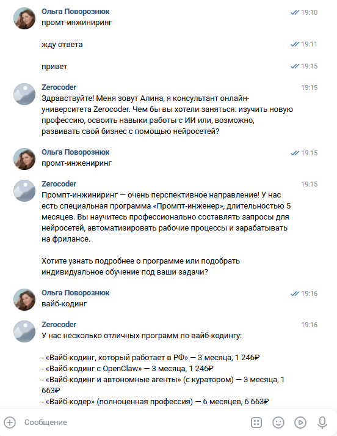
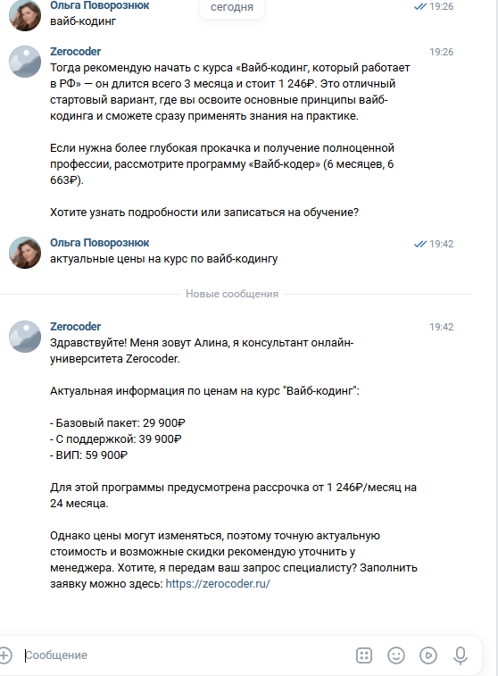
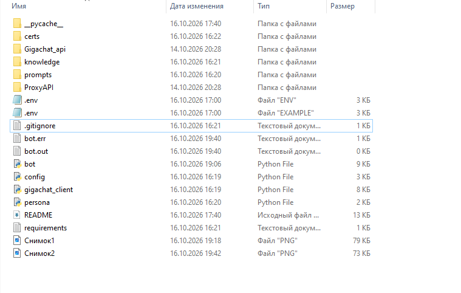
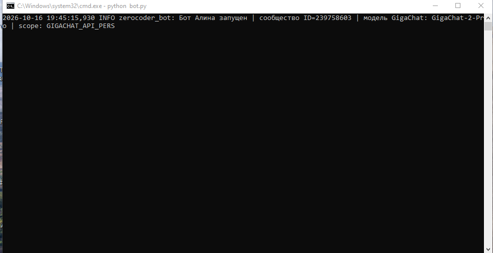

# Алина — чат-бот-консультант для сообщества ВКонтакте на GigaChat


Интеллектуальный ассистент **«Алина»** для сообщества ВКонтакте онлайн-университета
**[Zerocoder](https://zerocoder.ru/)**. Бот отвечает на вопросы потенциальных студентов о курсах,
ценах и программах обучения, ведёт диалог в переписке и отправляет ссылку на форму подбора
программы. Ответы генерируются российской моделью **GigaChat** (Сбер) с опорой на базу знаний —
бот не выдумывает факты и не уходит от темы.

## Скриншоты

| Диалог с ботом | Диалог с ботом |
|---|---|
|  |  |

| Диалог с ботом | Диалог с ботом |
|---|---|
|  |  |

## Возможности

- **Диалог с контекстом** — бот помнит последние сообщения диалога (настраивается через `HISTORY_LIMIT`),
  поэтому отвечает на вопросы с учётом предыдущих реплик.
- **Персонализация через промпт** — характер, тон общения и правила Алины описаны в
  `prompts/system_prompt.txt`; поведение меняется без правки кода.
- **База знаний** — актуальная информация о программах Zerocoder лежит в
  `knowledge/zerocoder_knowledge_base.md`; обновили курс — обновили один Markdown-файл.
- **Защита от «галлюцинаций»** — промпт запрещает выдумывать факты; по off-topic вопросам бот
  вежливо возвращает диалог к теме обучения.
- **Кнопка под сообщениями** — под каждым ответом «Подобрать программу» со ссылкой на форму
  заявки (`SALES_FORM_URL`).
- **Автоматическая работа с сертификатами** — корневой сертификат НУЦ Минцифры скачивается
  в `certs/` автоматически при первом запуске.
- **Устойчивость к сбоям** — при ошибке API пользователь получает вежливую заглушку, бот
  переподключается к Long Poll и продолжает работу; токен GigaChat обновляется автоматически.

## Как это работает

```
┌────────────┐   Bots Long Poll    ┌──────────────┐   chat/completions   ┌───────────┐
│  Пользователь │ ───────────────► │   bot.py     │ ───────────────────► │  GigaChat  │
│  ВКонтакте   │ ◄─────────────── │  (Python)    │ ◄─────────────────── │  API (Сбер) │
└────────────┘   messages.send    └──────┬───────┘   system prompt +    └───────────┘
                                        │         knowledge base
                                        ▼
                                 prompts/ + knowledge/
                                 (персона + база знаний)
```

1. `bot.py` слушает сообщения сообщества через **Bots Long Poll API** ВКонтакте.
2. Текст пользователя, история диалога и системный промпт (персона Алины + база знаний)
   отправляются в **GigaChat API** (`POST /v1/chat/completions`).
3. Клиент GigaChat сам получает OAuth-токен (`POST /api/v2/oauth`, живёт 30 минут) и
   обновляет его по истечении — ручная авторизация не нужна.
4. Ответ модели отправляется пользователю вместе с кнопкой «Подобрать программу».

## Технологии

| Компонент | Технология |
|---|---|
| Язык | Python 3.10+ |
| API сообщества | `vk_api` (Bots Long Poll) |
| Генерация ответов | GigaChat API (GigaChat-2-Pro по умолчанию) |
| HTTP-запросы | `requests` |
| Настройки | `python-dotenv` + `.env` |
| Сертификаты | НУЦ Минцифры (загрузка автоматически) |

## Структура проекта

```
├── bot.py                      # Точка входа: Long Poll ВК + отправка ответов
├── gigachat_client.py          # Клиент GigaChat: OAuth-токен + chat/completions
├── config.py                   # Чтение настроек и секретов из .env
├── persona.py                  # Сборка системного промпта из шаблона и базы знаний
├── prompts/
│   └── system_prompt.txt       # Персона Алины: роль, тон, правила
├── knowledge/
│   └── zerocoder_knowledge_base.md  # База знаний о программах обучения
├── docs/
│   ├── screenshots/            # Скриншоты диалогов с ботом
│   ├── gigachat-api/           # Материалы по GigaChat API (настройка Studio)
│   └── proxy-api/              # Материалы по ProxyAPI
├── .env.example                # Шаблон настроек (без секретов)
├── requirements.txt            # Зависимости Python
└── README.md
```

## Требования

- Python 3.10 и новее.
- Токен доступа сообщества ВКонтакте (права «Сообщения сообщества» и «Управление»).
- Ключ авторизации GigaChat API (Authorization Key из личного кабинета Studio).
- Доступ в интернет.

## Установка и запуск

```bash
# 1. Клонировать репозиторий
git clone https://github.com/olgapovoroznyuk-pixel/alina-vk-gigachat-bot.git
cd alina-vk-gigachat-bot

# 2. Создать виртуальное окружение
python -m venv .venv
.venv\Scripts\activate        # Windows
# source .venv/bin/activate   # Linux/macOS

# 3. Установить зависимости
pip install -r requirements.txt

# 4. Создать файл .env из шаблона и заполнить секреты
copy .env.example .env        # Windows
# cp .env.example .env        # Linux/macOS

# 5. Запустить бота
python bot.py
```

В логах появится `Бот Алина запущен | сообщество ID=... | модель GigaChat: ...`.
Откройте сообщество ВКонтакте и напишите ему в сообщения — бот ответит.
Остановка: `Ctrl+C`.

## Как заполнить .env

Откройте `.env` в текстовом редакторе и вставьте **свои** значения. Реальные секреты
хранятся только у вас локально — их нет в репозитории и их нельзя публиковать.

| Переменная | Обязательна | Для чего нужна и где взять |
|---|---|---|
| `VK_GROUP_TOKEN` | да | Токен сообщества ВК: **Управление → Работа с API → Создать ключ доступа**, права **«Сообщения сообщества»** и **«Управление»**. |
| `VK_GROUP_ID` | нет | Числовой ID сообщества (`vk.com/public123456` → `123456`). Если пусто — бот определит ID сам по токену. |
| `GIGACHAT_AUTH_KEY` | да | **Studio → проект GigaChat API → Настройки API → «Получить ключ»**. Поле Authorization Key показывается только один раз. |
| `GIGACHAT_SCOPE` | нет | `GIGACHAT_API_PERS` (физлица, по умолчанию), `GIGACHAT_API_B2B` / `GIGACHAT_API_CORP` (ИП и юрлица). |
| `GIGACHAT_MODEL` | нет | `GigaChat-2`, `GigaChat-2-Pro` (по умолчанию), `GigaChat-2-Max`, `GigaChat-3-Ultra`. |
| `GIGACHAT_CA_BUNDLE` | нет | Путь к сертификату НУЦ Минцифры, если он уже скачан. |
| `SALES_FORM_URL` | нет | Ссылка на форму заявки (по умолчанию `https://zerocoder.ru/`). |
| `HISTORY_LIMIT` | нет | Сколько последних сообщений диалога передавать модели (по умолчанию `12`). |

## Настройка сообщества ВКонтакте

1. Включите сообществу доступ к **Работа с API** (Управление сообществом → Работа с API).
2. Создайте ключ доступа с правами **«Сообщения сообщества»** и **«Управление»** → скопируйте токен в `VK_GROUP_TOKEN`.
3. В настройках сообщества откройте **Сообщения сообщества** → подключите их («ВКонтакте API»).
4. Включите **Long Poll API** и отметьте **типы событий** (минимум «Входящие сообщения»).
   Без включённых типов событий бот будет молчать. Бот при запуске сам включает подписку
   (`groups.setLongPollSettings`), если у ключа есть право «Управление».

## Сертификаты НУЦ Минцифры

Для запросов к GigaChat API нужен корневой сертификат Минцифры — иначе ошибка
`[SSL: CERTIFICATE_VERIFY_FAILED]`.

- По умолчанию бот **скачивает сертификат автоматически** в `certs/` при первом запуске.
- Либо укажите свой файл в `GIGACHAT_CA_BUNDLE`.
- Либо установите сертификат на уровне ОС с портала Госуслуг.

## Системный промпт и база знаний

- **Персона Алины** — `prompts/system_prompt.txt`: роль, женский род, тон общения, правила
  по off-topic вопросам, запрет выдумывать факты, когда предлагать форму продаж.
- **База знаний** — `knowledge/zerocoder_knowledge_base.md`: программы, цены, сроки,
  преимущества, собрано с [zerocoder.ru](https://zerocoder.ru/).
- Промпт подставляет базу знаний по плейсхолдеру `[[KNOWLEDGE_BASE]]`, а ссылку на форму —
  по `[[SALES_FORM_URL]]`. Обновили информацию о курсах — отредактируйте Markdown-файл,
  код менять не нужно.

## Безопасность

- **Секреты только в `.env`** — файл добавлен в `.gitignore` и не попадает в Git/GitHub.
- `.env.example` содержит только названия переменных и комментарии — без секретов.
- В коде секреты не хранятся и не выводятся в логи.
- Бот не запрашивает у пользователей пароли, коды и платёжные данные; единственная
  официальная форма — `SALES_FORM_URL`.

## Troubleshooting

| Ситуация | Решение |
|---|---|
| `Не заданы обязательные переменные окружения` | Скопируйте `.env.example` в `.env` и заполните `VK_GROUP_TOKEN` и `GIGACHAT_AUTH_KEY` |
| `GigaChat OAuth: HTTP 401/403` | Проверьте `GIGACHAT_AUTH_KEY` и `GIGACHAT_SCOPE` (scope должен соответствовать тарифу) |
| Ошибка SSL / `CERTIFICATE_VERIFY_FAILED` | Разрешите боту скачать сертификат (`certs/`) или укажите `GIGACHAT_CA_BUNDLE` |
| VK API ошибка при `groups.getLongPollServer` | Проверьте права токена и что «Работа с API» включена |
| Бот молчит на сообщения | Проверьте в **Работа с API → Long Poll API** типы событий (минимум «Входящие сообщения») |

## Ветки

- `main` — стабильная рабочая версия проекта.
- `dev` — ветка разработки: сюда вносятся изменения, затем они сливаются в `main`.

---

Сделано в рамках обучения в [Zerocoder](https://zerocoder.ru/) · Python + GigaChat API + VK Communities API
